Shani Shell is the desktop of Shani OS's niri edition — the bar, the dock, the launcher, the lock and sign-in screens, Quick Settings, notifications and 39 apps, built on the [niri](https://github.com/YaLTeR/niri) scrolling compositor with [Quickshell](https://quickshell.org).

One rule runs through all of it: **everything is a click or a glance away.** You pick settings from choices instead of typing values you would have to know, you sign in without typing a password, and when you are not using it, the desktop costs almost nothing.

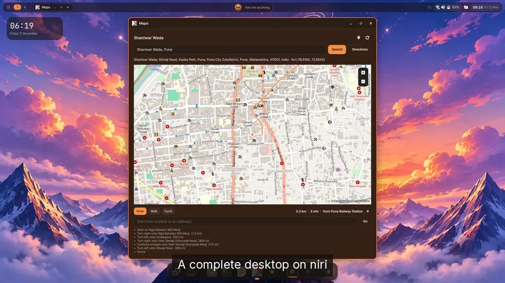

The tour in motion, 87 seconds: [watch the video](/assets/videos/meet-shani-shell-tour.mp4).

Everything in this post was recorded or photographed on a real Shani Shell session. Where something has only been proven in our test session and not yet on real hardware, we say so.

---

## Sign in without typing

Look at an infrared camera and you are in, as with Windows Hello. Or touch the fingerprint reader, or a YubiKey. Your password always works too, and is still asked for anything that changes the system. The sign-in screen already shows your name and picture — there is no user name to type — and the sign-in screen, the lock screen, first setup and the administrator prompt each have an on-screen keyboard that opens by itself when no keyboard is connected.

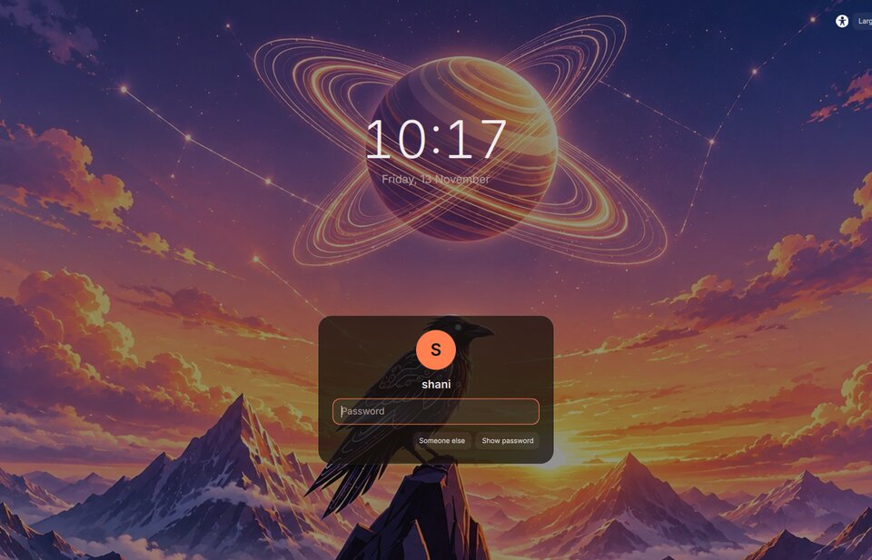

The lock screen is one you can use: notifications, what is playing, a camera button, restart and power off.

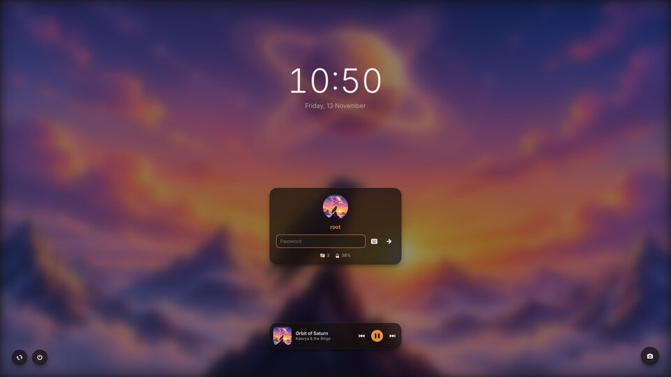

## A desktop that stays out of your way

A bar, a dock and, in the middle of the bar, the **Island**, which shows what is happening — a recording, a call, a timer, a print job — and acts on it when clicked. The bar and dock step aside when a window needs the room and come back at the edge. There is an overview of every window, Alt+Tab, hot corners, desktop layouts to try on with one click, and the **Ring**, a pie menu at the pointer:

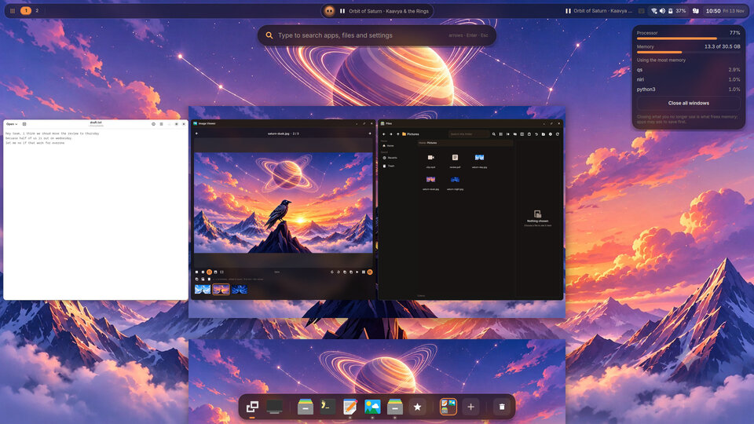

Windows open the way you choose — glide, pop or dissolve — with the corners, shadow and frosted glass set from Settings, not a config file.

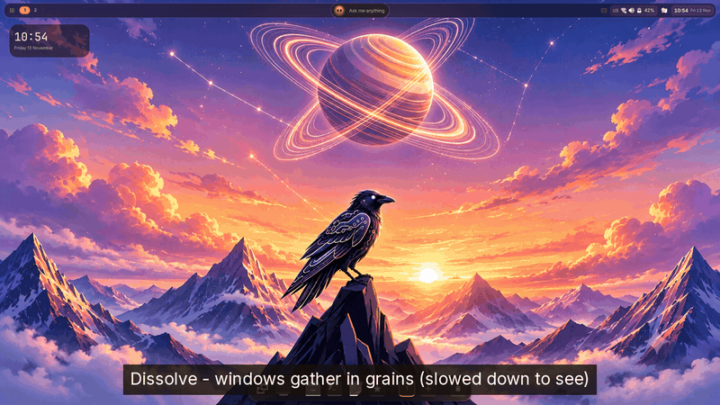

## Find anything

One launcher (**Super + Space**) finds apps, open windows, files and the words inside them, actions like "dark style" or "lock", sums and unit conversions, emoji and your clipboard history. Files is the shell's own file manager, and **Space** on any file shows it without opening an app:

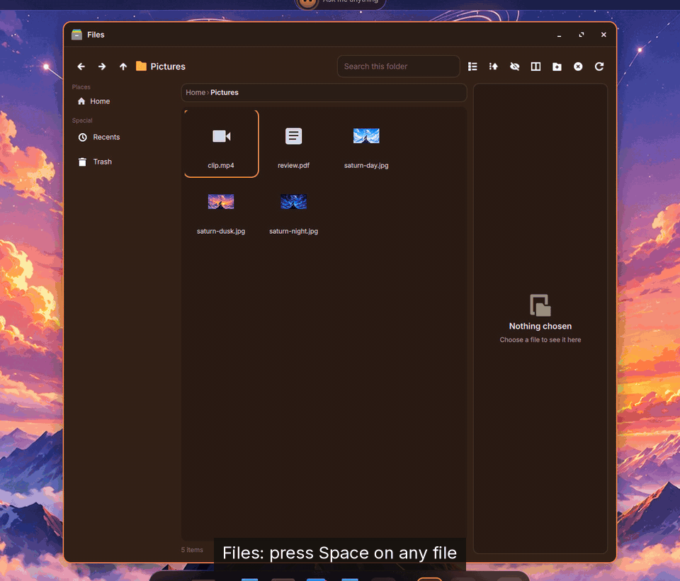

**Lens** (**Super + S**) reads any part of the screen on your computer — copy it, search it, translate it, or scan a QR code:

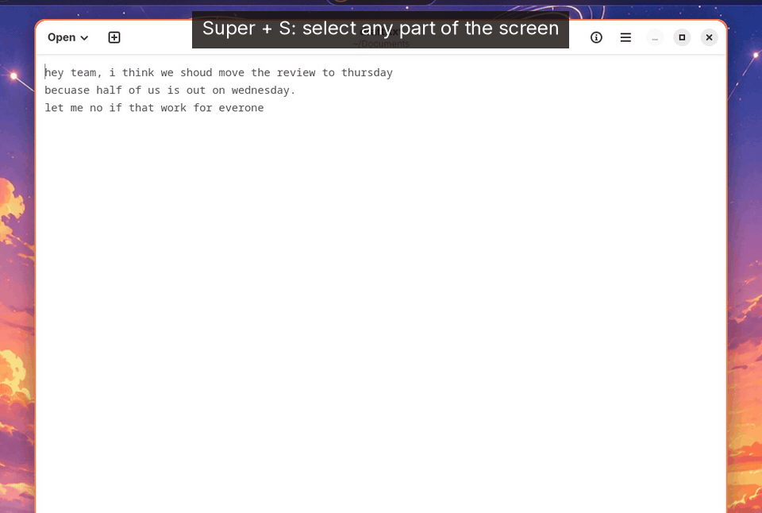

## 39 apps of its own

A fresh install is complete without a single download: Files, Text Editor, Media Player (it picks up where you left off, and shrinks to a mini player), Image Viewer, a Document Viewer for PDFs, e-books, comics and DjVu that also fills in PDF forms, Photos, Archive Manager, Calculator, Calendar, Tasks, Clocks, Weather, Notes, Maps with directions, Translate, Camera, Voice Recorder, Characters, Fonts, Disk Usage, Document Scanner, System Monitor, Logs, an Authenticator, Nearby Share (LocalSend), a Converter, a PDF Signer, a Video Trimmer, a Kundali — and Settings. They share one look and one launcher, and open your files by default.

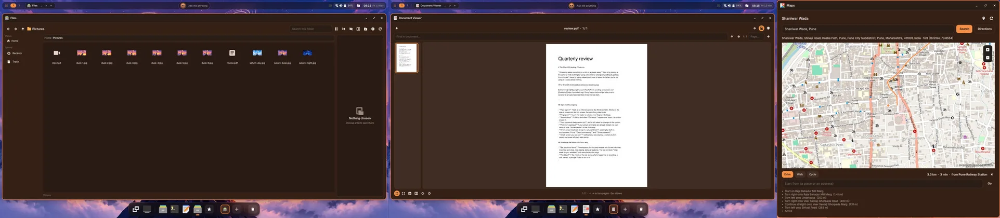

## Built for everyone

Every control has a name a screen reader can say — checked with real accessibility tools, not assumed. There is large text, high contrast, reduce motion, mono audio, a magnifier, live captions and read-aloud, and the whole desktop can be driven by keyboard alone or by a game controller (A selects, B goes back, Start opens Quick Settings).

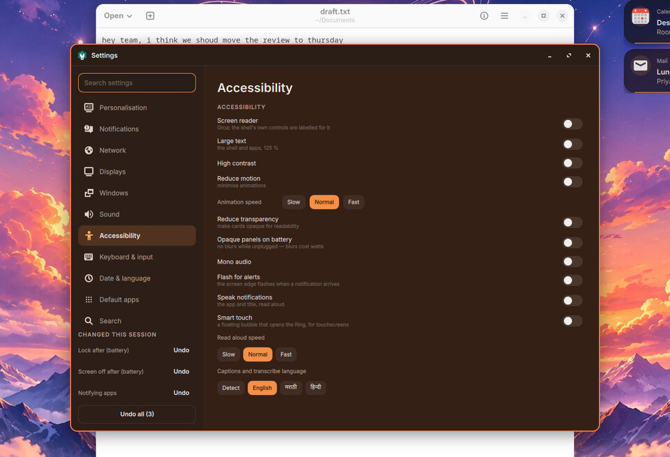

For India in particular: the on-screen keyboard has a hand-made Marathi layout where a vowel after a consonant becomes its sign, plus any of xkb's 598 layouts — 45 of them Indian. Handwriting is read on your computer in English, Hindi and Marathi, and fcitx5 comes with Hindi phonetic ready.

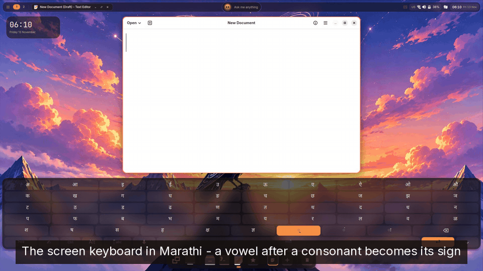

Or don't type at all: tap the keyboard's microphone and speak. The words are heard on your computer — by the same speech engine Chronoa uses — and typed where you were.

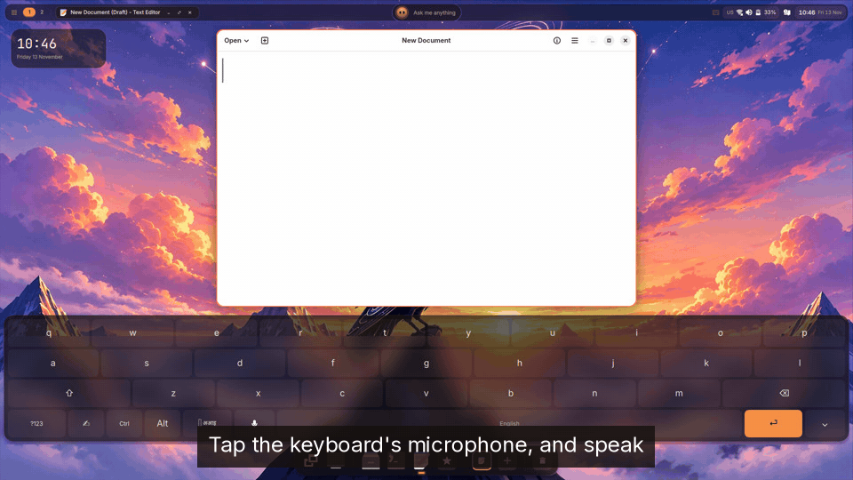

First setup speaks six languages — English, मराठी, हिन्दी, Deutsch, Español and Français — and offers accessibility from its first screen.

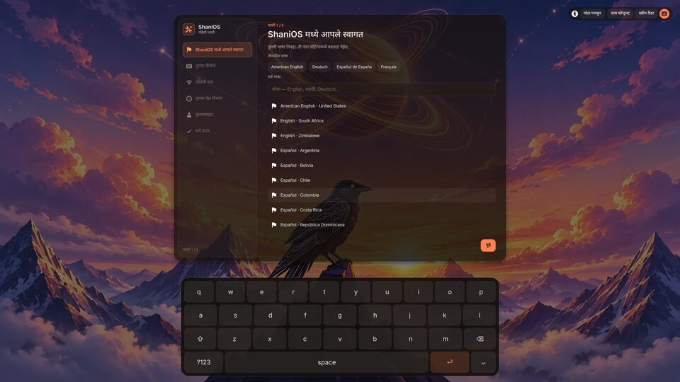

## Your devices, and your phone

Plug something in and the desktop says what it can do with it, once: a monitor asks whether to extend, mirror or present (Do Not Disturb, and no sleep, until it is unplugged); a camera offers to import; a security key offers sign-in; a game controller shows its battery and a button test. Bluetooth pairing shows the code big and clear.

With **Shani Link**, your phone is part of the desktop: calls from your phone, a landline or the laptop's own modem ring once, on the Island; texts, one address book and one call history; your Android phone's screen in a window; the screen locks itself when your phone walks out of range.

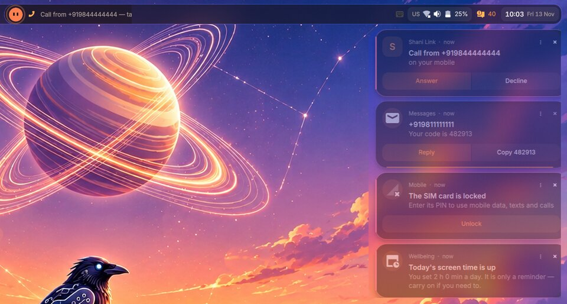

On a handheld, **InputPlumber** makes its built-in controls the kind of controller a game expects, and the guide button opens Quick Settings over the game — the game sees no press until you close it. On a desktop, a **UPS** is watched too: a power cut is said the moment the UPS takes over, with how long it will last.

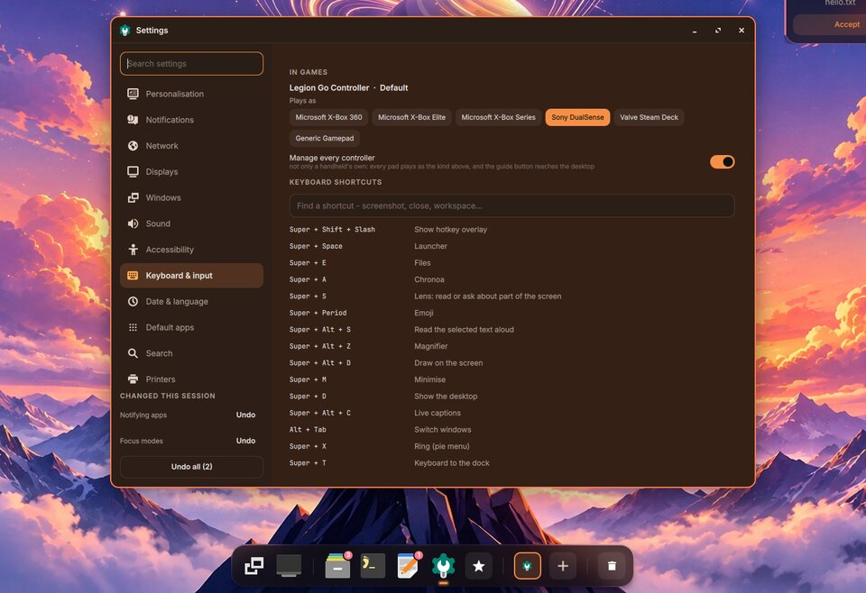

## Power, privacy and family

Settings shows how worn your battery is and what is keeping the processor busy.

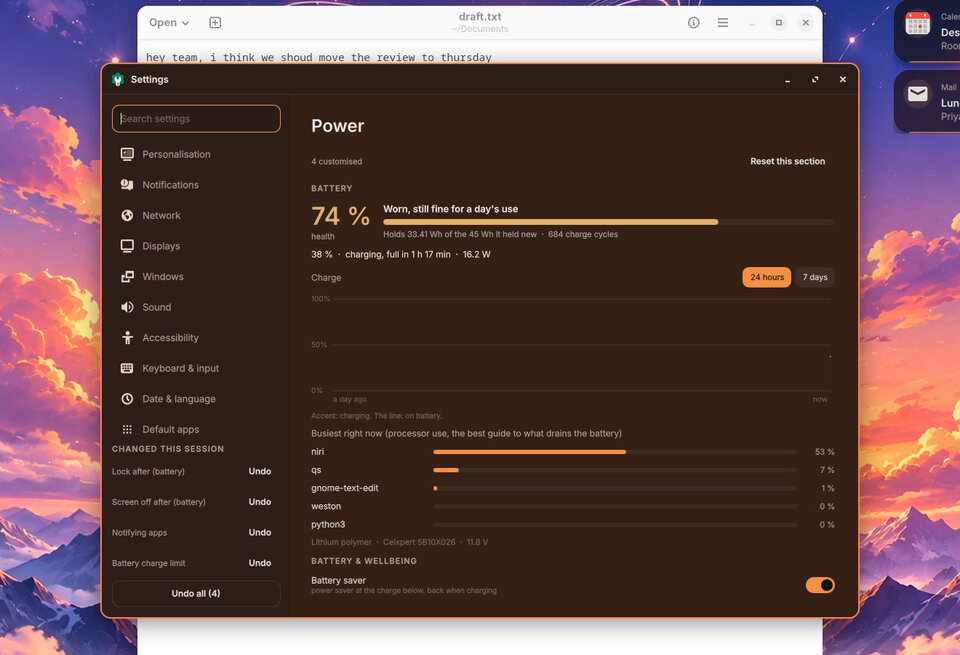
 Laptops sleep and then hibernate so a flat battery never loses your work, fast screens drop to 60 Hz on battery, and every display change is confirmed or undone in 15 seconds. Earlier versions of your files come from daily snapshots, backups go to another drive, and parental controls keep apps a child shouldn't use out of their launcher and dock.

## An assistant that is part of the desktop — and asks first

Shani Shell works without an assistant. With **Chronoa** installed (`shani-chronoa`), it lives in the middle of the bar, runs a model on your own computer, and **asks before it changes anything** — in the bar, without opening a window:

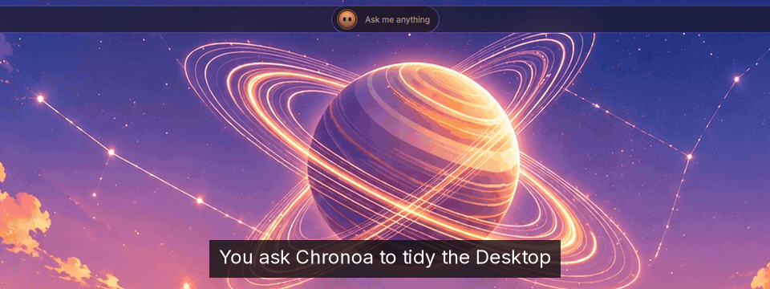

You can ask it from the launcher (**Ctrl + Enter**), about a notification, a file, a window or a terminal error. Select text in any app and **Super + Shift + W** proofreads, rewrites or translates it and puts the result back where it was:

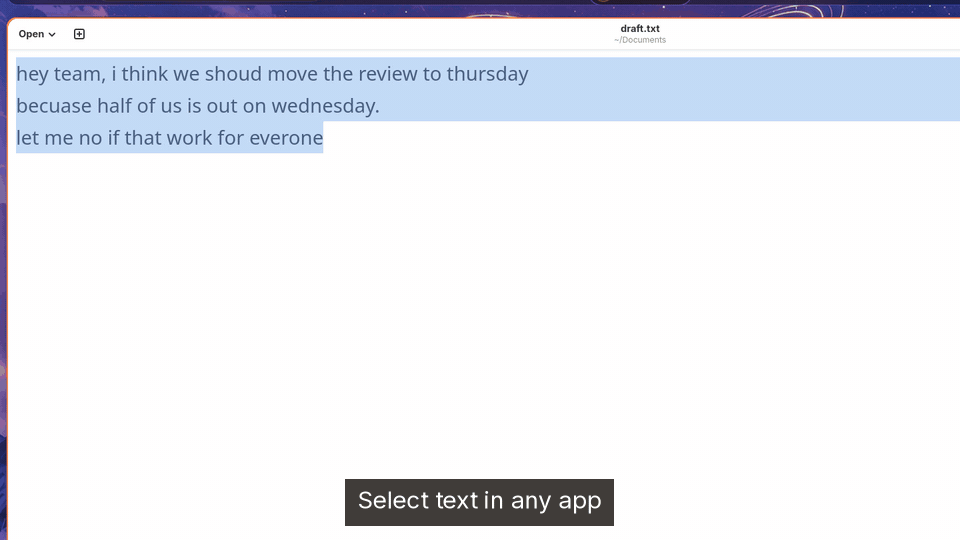

It also writes suggested replies on message notifications, names files from their own words, and powers live captions and voice typing — all on the machine.

## Light, and tested by running it

At rest the shell draws nothing and starts at most a few programs a minute. The test suite measures exactly that, along with memory, start-up time and leaks, so a feature that polls in the background fails by name. More than 700 checks drive the real shell in a nested session — keystrokes, D-Bus, real daemons — and read back what it did. Recording the clips for this post found and fixed four bugs that reading the code had not: the dock's rounded ends were cut off, Maps stayed blank after a search, an answer from the launcher appeared nowhere, and the cards over Files were see-through.

## What it does not do yet

We would rather you hear this from us:

- **Proven in a test session, not yet on an installed image.** Everything above runs in our nested test session. A full run on a real Shani OS install, and the features that need real hardware — Wi-Fi edge cases, real Bluetooth pairing, two screens, face and fingerprint sign-in, the camera, modem calls — still have to be checked on real machines. Our [known gaps](https://github.com/shani8dev/shani-shell/blob/main/docs/GAPS.md) list every one.
- **Translations are partial.** Marathi and Hindi are translated for the shell's main surfaces (1527 of 2347 strings; the newer app windows and settings still show in English); German, Spanish and French cover setup only.
- **What niri cannot give yet:** remote desktop through the portal, colour management, "always on top", sticky keys handled by the compositor.
- **Not built:** online accounts, a session chooser at sign-in, and an office suite or browser of our own — those stay Flatpaks.

## Try it

Shani Shell is the desktop of Shani OS's niri edition. On Arch, add the `[shani]` repository (`https://repo.shani.dev/$arch`) and install `shani-shell shani-desktop-niri`; Chronoa is optional.

The source, every feature with its test, and the known gaps: **[github.com/shani8dev/shani-shell](https://github.com/shani8dev/shani-shell)**.
